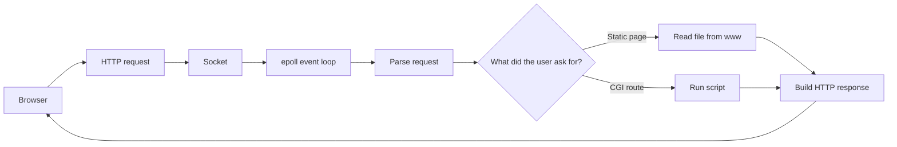
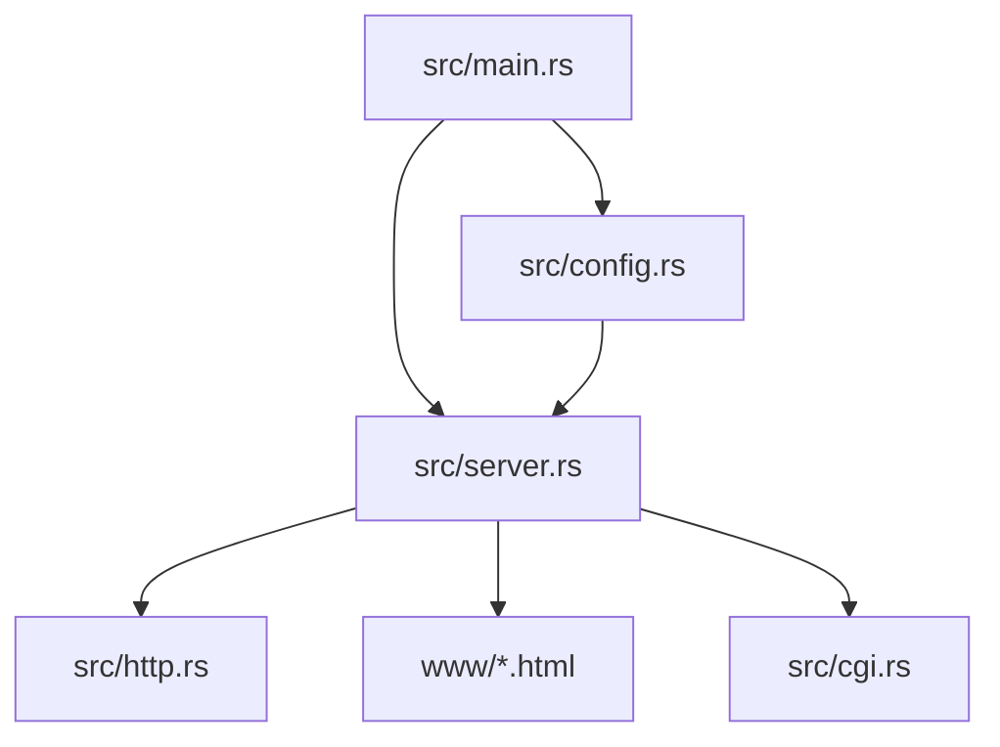
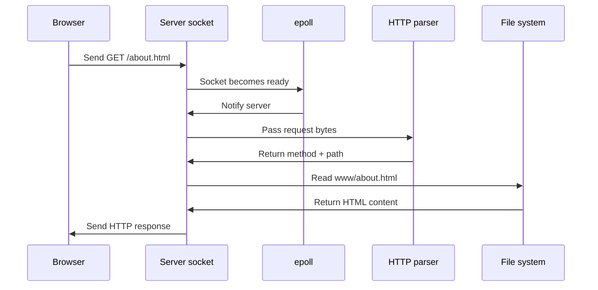
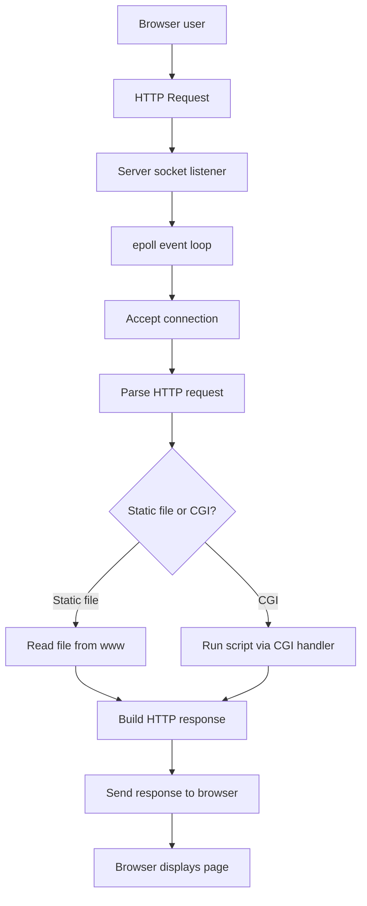

# Localhost Project Overview

This project is a small custom web server written in Rust. The goal is to understand how the web works "from the server side" by building the basic pieces of an HTTP server yourself instead of relying on a framework.

## Core concepts used

This project is mostly about networking and request handling. The main ideas are:

- sockets: the low-level network endpoint the server uses to talk to browsers
- epoll: the event system that tells the server when a socket has activity
- HTTP parsing: reading the request line, headers, and later the body
- file system access: reading HTML files from the `www` folder
- configuration: storing ports, routes, default files, and limits
- CGI: running a separate program for dynamic responses
- non-blocking I/O: making reads and writes behave without freezing the whole server
- status codes: sending `200`, `404`, `400`, and similar HTTP results

One important point: this project does not use threads for request handling. It is designed as a single-process, single-thread server that waits on events instead of spawning worker threads.

## Visual map

### 1. Big picture

### 2. How the code is split

### 3. One request step by step

## What the project is trying to do

A browser sends an HTTP request to the server. The server:

1. listens for incoming connections,
2. reads the request,
3. decides what resource the client wants,
4. prepares an HTTP response,
5. sends the response back to the browser.

In other words, the server acts like a receptionist, a translator, and a delivery service all at once.

---

## What has been implemented so far

### 1. Program entry point
The startup logic in [src/main.rs](src/main.rs) does the first setup:

- loads configuration,
- creates a server instance,
- starts the server loop.

### 2. Server socket setup
The server in [src/server.rs](src/server.rs) is already doing the low-level networking work:

- creates a socket,
- binds it to a port,
- listens for connections,
- uses `epoll` to wait for events,
- accepts new clients.

This is the core connection layer. A socket is the actual network door, and `epoll` is the wait-and-notify system that tells the server when someone is knocking.

This is the foundation of the server. It is the part that lets the machine receive traffic from the browser.

### 3. Basic request handling
The same server code reads incoming bytes from a client, tries to parse them as an HTTP request, and then:

- maps `/` to `/index.html`,
- reads files from the `www` folder,
- returns a simple HTML response.

At this stage the server is matching a URL path to a file path. That is the link between the browser request and the HTML page you see.

So a request like `/about.html` can currently be served from the static files in the website folder.

### 4. HTTP request parsing
The module in [src/http.rs](src/http.rs) parses the first line of an HTTP request and extracts the method, URI, and version.

This is an important step because the server needs to understand what the browser is asking for before it can respond.

Later this same layer would also be used to read headers like `Host`, `Content-Length`, and any body data for `POST` requests.

### 5. Configuration skeleton
The config layer in [src/config.rs](src/config.rs) defines the structure for server settings such as:

- host,
- port,
- default file,
- route information,
- body size limits.

The current implementation is still a simplified placeholder, but it gives the project a clear shape.

### 6. CGI skeleton
The file [src/cgi.rs](src/cgi.rs) creates a placeholder structure for handling CGI scripts. This is the part that will eventually allow dynamic execution of scripts like Python or PHP.

CGI is not about drawing images or doing graphics. It is about running a program on demand so the server can build a response dynamically instead of reading a fixed file.

---

## What each concept does in the full picture

### Sockets
Sockets are how the server communicates with the network. Think of a socket as the server’s phone line. The browser calls it, and the server answers.

### Epoll
`epoll` is the server’s waiting mechanism. Instead of checking every connection in a busy loop, the server asks `epoll` to notify it when something is ready to read.

### HTTP
HTTP is the language between browser and server. It defines the request format, the response format, and the meaning of the status codes.

### Config
The config file tells the server what to listen on and how to behave. It is where route rules, body limits, and error page settings belong.

### Static files
Static files are plain files on disk, like `index.html` or `about.html`. The server reads them and sends them back without changing them.

### CGI
CGI is the dynamic path. When a route needs logic, the server can hand the request to another program and use that program’s output as the response.

### Threads
Threads are a common way to handle multiple requests at once, but this project is not using them. The design here is closer to one server loop watching many sockets.

### Non-blocking I/O
Non-blocking I/O means the server does not sit stuck waiting on one connection. It checks what is ready, handles it, and keeps moving.

---

## What still needs to be done

The project is still a working prototype, not a full production-ready web server. The main missing pieces are:

### 1. Full configuration parsing
Right now the config file is not fully interpreted. The server mostly falls back to a default config.

Needed work:

- parse the config file properly,
- support multiple routes,
- support custom error pages,
- support body size rules.

### 2. Better HTTP handling
The current parser is basic. It does not yet fully support:

- headers beyond a simple parse,
- request bodies,
- chunked transfer encoding,
- proper keep-alive behavior,
- many HTTP status codes.

### 3. Full support for methods
The project should eventually support the required methods properly:

- `GET`
- `POST`
- `DELETE`

Right now the behavior is mostly static file serving and simple response generation.

### 4. CGI support
CGI is still only a skeleton. The server should eventually:

- detect file extensions,
- run the correct interpreter,
- pass the request body and environment variables properly,
- return the script output as the HTTP response.

### 5. Error pages and robust responses
The server should return proper error pages for codes such as:

- 400 Bad Request
- 403 Forbidden
- 404 Not Found
- 405 Method Not Allowed
- 413 Payload Too Large
- 500 Internal Server Error

### 6. Security and reliability improvements
The project description also expects features such as:

- timeout handling,
- non-blocking I/O discipline,
- no crashes,
- stress testing,
- memory safety checks,
- proper handling of uploads and cookies/sessions.

---

## How the pieces are linked together

In plain English, the flow looks like this:

1. The user opens a browser and types a URL.
2. The browser creates an HTTP request and sends it to the server.
3. The server listens on a port through a socket and waits for that request with `epoll`.
4. When data arrives, the server accepts the connection and reads the request bytes.
5. The HTTP module tries to understand the request.
6. The server looks at the route and decides whether the request is static or CGI.
7. If it is static, it reads the file from disk.
8. If it is CGI, it runs the script and uses its output.
9. The response is built with the right status code and headers.
10. The response is sent back to the browser.
11. The browser displays the page.

A simple mental model is:

- [src/main.rs](src/main.rs) = starts everything
- [src/server.rs](src/server.rs) = receives traffic and manages connections
- [src/http.rs](src/http.rs) = understands HTTP requests and responses
- [src/config.rs](src/config.rs) = stores the server rules
- [src/cgi.rs](src/cgi.rs) = will handle dynamic script execution
- [www](www) = stores the static website files
- the OS networking layer = provides sockets and epoll support

---

## Diagram

---

## Current status

The project currently builds successfully with Rust, and the server can start and serve simple static files. It is still a foundation rather than a complete web server.

## Suggested next steps

If you want to continue this project, the best order is:

1. finish the config parser,
2. improve request parsing,
3. support proper routing and error pages,
4. add CGI execution,
5. test with real browser requests and stress cases.
